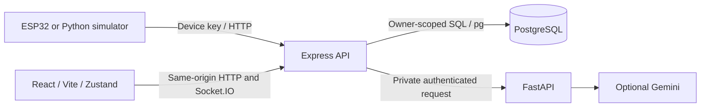

# Architecture

Vyana is the interface name; HealthGuard remains in service and package identifiers.

## Data flow

Each account owns its profile, contacts, devices, readings and alerts. One selected device supplies live metrics and daily totals. Device credentials are stored hashed; browser tokens identify an account and revocable session.

Ingest locks the device row, deduplicates the producer identity and updates alert episodes in one transaction. Socket broadcasts follow commit. The browser recovers authoritative snapshots over REST after reconnecting; socket delivery is not durable storage.

Observations have UTC acquisition and receipt times plus a device/session/sequence identity. Delayed replay is retained as history without replacing newer live readings. Daily activity uses cumulative-counter deltas in the profile's IANA timezone.

Core summaries use deterministic rules and never wait for Gemini. The API supplies owner-scoped context to a private AI service. Context, concurrency, cache and output are bounded. Missing data, provider failures and invalid model output have explicit fallback states.

## Storage

[Versioned SQL migrations](../apps/api/migrations) are authoritative. Startup checks checksums and obtains a migration lock before listening.

| Table | Stores |
|---|---|
| users | Account identity, password hash and account state |
| sessions | Rotating refresh hashes and session lifetime |
| account_tokens | Single-use recovery/verification token hashes |
| delivery_outbox | Encrypted operator delivery payloads |
| devices | Owner, credential hash, active selection and heartbeat |
| profile | Measurements, notes, timezone and onboarding state |
| emergency_contact | Owned contact channels and relationship |
| vitals / activity | Owned readings, producer identity and UTC times |
| alerts | Severity, metric/direction episode and lifecycle state |
| schema_migrations | Applied versions and checksums |

Owner/time/status indexes support bounded queries. Telemetry identity is unique per device/session/sequence and table. Active metric/direction episodes are unique per device. `timestamp` is a generated compatibility alias for `observed_at`.

Original unowned data stays in restricted `legacy` until an operator chooses an existing owner and source timezone. See [operations](OPERATIONS.md) for import, backup and retention.

The running stack has no Prisma, Next.js, MQTT, vector/RAG memory, trained classifier or agent orchestrator. Firmware DSP/activity and the UI ECG are simulated. [Features](FEATURES.md) and [API contracts](API.md) describe the current boundaries.
