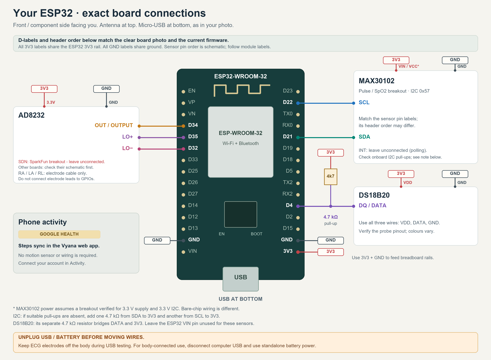

# Connections for the current ESP32 firmware

[Download board diagram SVG](esp32-board-connections.svg). The ESP32 header order and D-labels are transcribed from the user's latest clear photograph. View the front/component side with the antenna at the top and micro-USB at the bottom. The photo shows 15 header pins per side; ESP32 is the processor family name. Sensor terminal positions are schematic: follow the labels on each actual module.

## Exact printed labels and positions

| Component signal | Printed ESP32 label | Position in the supplied photo |
|---|---|---|
| MAX30102 SDA | D21 (GPIO21) | Right; between RX0 and D19 |
| MAX30102 SCL | D22 (GPIO22) | Right; between D23 and TX0 |
| DS18B20 DATA | D4 (GPIO4) | Right; between RX2 and D2 |
| AD8232 OUTPUT | D34 (GPIO34) | Left; immediately below VN |
| AD8232 LO+ | D35 (GPIO35) | Left; immediately below D34 |
| AD8232 LO− | D32 (GPIO32) | Left; immediately below D35 |
| Shared 3.3 V rail | 3V3 | Bottom pin on the right |
| Shared ground rail | GND | Right, immediately above 3V3; or left, immediately above VIN |

For this photographed board, the listed D-number labels correspond to the same GPIO numbers used in the firmware. D1 and D2 are not substitutes for D21 and D22. The current code does not need D1 or D2.

## Assembly steps

1. Unplug USB and any battery before inserting or moving wires. Keep ECG electrodes off the body throughout USB programming and bench checks.
2. Connect the bottom-right **3V3** to the breadboard positive rail. Connect the **GND immediately above it** to the ground rail. If the breadboard rails are split, bridge the matching rail sections. Never join 3V3 and GND.
3. Connect MAX30102 SDA to **D21**, SCL to **D22**, GND to the ground rail, and the verified 3.3 V-compatible breakout supply pin to the 3V3 rail. Leave INT unconnected. The supply connection remains conditional on the actual breakout's specification.
4. Connect DS18B20 VDD to 3V3, GND to ground and DQ/DATA to **D4**. Add the **4.7 kΩ pull-up from DATA/D4 to 3V3**. Verify the probe wire identities from its pinout instead of relying on cable colours.
5. Connect AD8232 3.3V to 3V3, GND to ground, OUTPUT to **D34**, LO+ to **D35**, and LO− to **D32**. On the SparkFun breakout, leave SDN unconnected: its onboard 10 kΩ pull-up already enables normal operation. For a different breakout, check its schematic before adding an SDN wire. RA/LA/RL are for the electrode cable, not GPIOs; leave electrodes off the body while USB is connected.
6. Phone activity syncs separately through Google Health in the Vyana web app; it requires no motion sensor or additional wiring. Leave ESP32 VIN unused for these sensor connections.
7. Check the pin labels, common ground and supply polarity with power off. Then reconnect USB, press EN to restart (sensor detection runs at startup), and use a 115200-baud serial monitor. MAX30102 and DS18B20 should become present after successful wiring; SpO2/heart-rate validation also needs stable finger contact and a complete measurement window.

## Full electrical mapping

| Component | Component pin | ESP32 / connection |
|---|---|---|
| MAX30102 compatible breakout | VIN / VCC | 3V3, subject to breakout voltage verification |
| MAX30102 | GND | GND |
| MAX30102 | SDA | GPIO21 |
| MAX30102 | SCL | GPIO22 |
| MAX30102 | INT | Unconnected; firmware polls |
| DS18B20 | VDD | 3V3 |
| DS18B20 | GND | GND |
| DS18B20 | DQ / DATA | GPIO4 |
| DS18B20 pull-up | 4.7 kΩ resistor | Between DATA/GPIO4 and 3V3 |
| AD8232 | 3.3V | 3V3 |
| AD8232 | GND | GND |
| AD8232 | OUT / OUTPUT | GPIO34 |
| AD8232 | LO+ | GPIO35 |
| AD8232 | LO− | GPIO32 |
| AD8232 | SDN | Leave unconnected on SparkFun breakout; onboard pull-up enables operation |
| AD8232 | RA / LA / RL | Electrode cable; these are not ESP32 GPIO connections |

All GND connections share the ESP32 ground; every 3V3 label shares its 3.3 V rail. Leave V5 unused for these sensor connections. The DS18B20 uses three-wire external power; its pull-up bridges DATA to 3V3 and is not in series with DATA. Identify the probe wires from their supplied pinout, since cable colours vary.

The MAX30102 connections assume a breakout explicitly supporting a 3.3 V supply and 3.3 V I2C. They do not describe a bare MAX30102 IC, which requires separate supplies. Check your module's schematic and pull-ups before powering it. The bare IC's requirements are documented in the [Analog Devices MAX30102 datasheet](https://www.analog.com/media/en/technical-documentation/data-sheets/MAX30102.pdf); external-power DS18B20 wiring is in the [DS18B20 datasheet](https://www.analog.com/media/en/technical-documentation/data-sheets/ds18b20.pdf).

SDA and SCL need pull-ups compatible with the ESP32's 3.3 V logic. Many breakout boards already include them; verify the board schematic and the rail they connect to. If suitable pull-ups are absent, add one 4.7 kΩ resistor from SDA to 3V3 and another from SCL to 3V3. These are separate from the DS18B20 pull-up. If the breakout requires different logic levels, use appropriate level translation instead of assuming a direct connection.

The signal GPIO mapping was rechecked against the source. Full physical compatibility is still conditional on the actual breakout board revisions and probe pinout; the diagram is not a verified schematic for unidentified modules. SDN must be logically HIGH for operation, but this does not require an external wire when the breakout supplies a pull-up. The [SparkFun schematic](https://cdn.sparkfun.com/datasheets/Sensors/Biometric/AD8232_Heart_Rate_Monitor_v10.pdf) shows R15 (10 kΩ) from SDN to 3.3V, and its [hookup guide](https://learn.sparkfun.com/tutorials/ad8232-heart-rate-monitor-hookup-guide/) leaves SDN unused. The current diagram leaves SDN unconnected for that breakout. Older copies saying "SDN (if exposed): connect to 3V3" are superseded. An SDN-to-3V3 connection holds the chip enabled; the old wording does not establish the cause of the observed ADC clipping.

## ECG use on the body

Disconnect power before changing wires. **Before attaching electrodes, disconnect the ESP32 from computer USB, mains chargers, oscilloscopes and any other mains-connected equipment. Run the complete circuit from a standalone battery source that is not charging.** Upload code while the electrodes are off the body, then unplug the computer and use wireless or onboard logging for body-connected operation. A normal USB cable does not provide patient isolation. Ordinary hobby isolators do not establish medical safety.

Use RA/LA/RL placement from the electrode module manufacturer's instructions. This circuit is an educational prototype; these modules and this wiring do not establish diagnostic accuracy or suitability for medical decisions. The waterproof temperature probe measures its local contact temperature; do not interpret it automatically as core body temperature.

## Diagram source

The source assignments are `Wire.begin(21,22,MAX30102_I2C_HZ)` in [main.cpp](../../esp32/src/main.cpp), with a default 100,000 Hz clock, `ONE_WIRE_BUS = 4` in [DS18B20_Driver.h](../../esp32/src/sensors/DS18B20_Driver.h), and `LO_PLUS = 35`, `LO_MINUS = 32`, `ECG_OUTPUT = 34` in [AD8232_Driver.h](../../esp32/src/sensors/AD8232_Driver.h). Steps and distance come from the separate [Google Health integration](../../../docs/GOOGLE_HEALTH.md).

Regenerate the board-specific PNG and SVG with `python hardware/wiring/esp32-current-code/draw_board_diagram.py` from the project root (requires Pillow). The generator checks all six signal GPIO assignments against the firmware before drawing.
